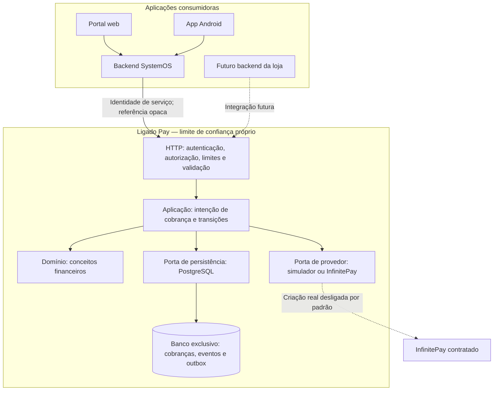

> Atualização de 29/10/2026: consulte o [estado consolidado](ESTADO_ATUAL.md). Os marcos datados abaixo são históricos; não representam, por si só, a versão ativa, a instalação atual ou novas validações.

# Arquitetura executável

Base local de 25/10/2026, atualizada em 26/10/2026. Monólito modular, exclusivamente API. Simulação é o padrão; a versão 0.2 permite composição local InfinitePay com criação real desligada por padrão. Este é o marco histórico da base local; a produção privada foi implantada posteriormente, conforme [estado atual](ESTADO_ATUAL.md) e [contrato operacional](PRODUCAO_PRIVADA.md). [Fluxo InfinitePay atual](infinitepay.md).

## Direção das dependências

- `src/domain`: tipos financeiros e erros; não conhece HTTP, PostgreSQL ou SystemOS.
- `src/application`: casos de uso e portas; não importa o cliente de banco nem SDK de provedor.
- `src/infrastructure`: repositórios transacionais, migrações, segredo protegido, simulador e adaptador InfinitePay.
- `src/http`: autenticação de serviço, validação estrita e exposição dos casos de uso.
- `src/main.ts`: composição, configuração, inicialização e desligamento.
- `migrations`: SQL versionado com checksum e exclusão mútua do runner.

## Controles presentes nesta base

- Inicialização somente local, host fixo `127.0.0.1`; implantação de produção recusada. Simulação/sandbox é o padrão; InfinitePay é opção explícita de conta financeira de produção, com criação desligada por padrão. PostgreSQL também deve ficar em loopback, separado do SystemOS.
- Token local aleatório de 256 bits; configuração da API contém somente seu hash. Comparação de hash em tempo constante. Isso é uma credencial local de desenvolvimento, não substitui mTLS/identidade curta em produção.
- Permissões e recebedores por aplicação. Consulta sempre limitada à aplicação e aos recebedores autorizados. Nenhuma identidade/credencial é aceita no corpo para sobrepor a autenticação.
- Limite de corpo, timeouts, bloqueio de chamadas de navegador, schemas sem campos extras e sem coerção silenciosa. Sem confiança em cabeçalhos de proxy.
- Limite de entrada local por IP com memória limitada; limite autenticado persistente por aplicação, compartilhado entre processos. Não confiar no IP como identidade de negócio.
- Migração e execução usam identidades diferentes. A API recusa superusuário e papéis com criação de bancos/papéis ou bypass de RLS. O isolamento atual é imposto nas consultas e autorizações; RLS ainda não foi implementado.
- Papel runtime só pode atualizar estado/referência do provedor/data na cobrança; não pode alterar o valor ou o recebedor. O teste local verifica esses privilégios e executa criação/leitura/repetição com esse papel.
- Intenção, evento financeiro e outbox gravados na mesma transação antes de chamar o provedor. Chave persistente com hash do conteúdo; exclusividade também por referência externa, impedindo recobrança com outra chave nesta versão.
- Bloqueio transacional por aplicação/recebedor e restrições únicas no banco. Chamadas simultâneas obtêm o mesmo identificador; não provocam novas chamadas ao provedor.
- Erro do provedor deixa `UNCERTAIN`. Interrupção após reserva pode deixar `PROCESSING`; nenhum dos dois provoca reenvio automático. Reconciliador ainda pendente, portanto esses estados exigem tratamento futuro antes de produção.
- Histórico protegido contra UPDATE/DELETE por trigger e privilégio restrito do papel de execução. Não é proteção absoluta contra administrador do banco/host.
- Erros públicos não incluem mensagem de driver, stack, token, URL fornecida ou payload. Logging de requisições está desabilitado nesta base para evitar vazamentos; observabilidade operacional segura ainda pendente.

## Limites do primeiro contrato

`POST /v1/payments` cria uma intenção simulada de Pix; `GET /v1/payments/:id` consulta. Há uma cobrança por referência externa, aplicação e recebedor. Parcelamento comercial, pagamentos parciais e novas tentativas de uma referência não são suportados nesta etapa.

O simulador não gera QR pagável, link de checkout, transação real ou estado pago. A resposta informa `simulated: true` e `realPaymentsEnabled: false`. Não conectar essa simulação à aprovação real de serviços. No modo InfinitePay, a resposta usa `simulated=false`, `provider=infinitepay` e ambiente financeiro `production`, com criação real conforme switch explícito. Pagamento confirmado é registrado com exclusividade de transação e eventos atômicos; os testes ainda são locais e não autorizam liberação de serviços reais.

A API atual inclui notificações encaminhadas por proxy autenticado, consulta financeira e rotas privilegiadas de operação; consulte o contrato versionado e [operação Pix](operacao-pix.md). Não há endpoint que devolva dinheiro no provedor. Os limites descritos acima como primeiro contrato são históricos.

## Barreiras para produção

Permanecem obrigatórios: identidade entre serviços com transporte autenticado, cofre/rotação/revogação, configuração de produção separada, isolamento reforçado do banco, limites financeiros agregados por período, conciliação, reenvio de eventos autenticados, conectores homologados, proteção dos webhooks, monitoramento, backups/restauração e revisão de segurança independente. Não remover o bloqueio de produção apenas para disponibilizar uma demonstração.
